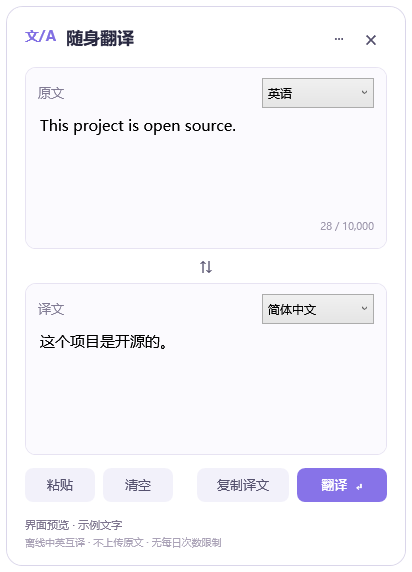

# 随身翻译 · TranslatorPet

一个小巧的 Windows 悬浮翻译助手。平时只显示圆球，点击后展开翻译窗口。**中英翻译在本机运行，没有在线服务的每日额度，也不上传原文。**

[English](README.en.md) · [贡献指南](CONTRIBUTING.md) · [第三方许可](THIRD_PARTY_NOTICES.md)

当前版本：**v0.3.0，早期可用版本**。面向 Windows 10/11 x64，先支持英语和简体中文双向翻译。此版升级为 Qwen3-4B-Instruct-2507 增强离线模型，优先改善英文阅读和技术注释的翻译质量。

**[⬇ 点击下载 Windows 免安装版（程序包）](https://github.com/6y-yyyyy/translator-pet/releases/download/v0.3.0/TranslatorPet-v0.3.0-windows-x64.zip)** · [使用教程](#使用教程) · [发布页面](https://github.com/6y-yyyyy/translator-pet/releases/tag/v0.3.0)

## 做这个项目的初衷

在使用 GitHub 或阅读英文文章时，我想尝试自己读懂原文，所以不希望直接把整页内容都翻译成中文。但读着读着，总会遇到一些不认识的单词，或是看不懂的句子，需要查一下才能继续。

因此，我想做一个随时能打开、又不占地方的小工具：平时安静地待在桌面上，只是一个小小的悬浮球；遇到不懂的地方，就复制文字、点开它、粘贴翻译，看懂后收起，继续读原文。也希望它能帮到有同样阅读习惯的人。



源码：[6y-yyyyy/translator-pet](https://github.com/6y-yyyyy/translator-pet)。欢迎提交问题和改进。

## 使用教程

**适用电脑：Windows 10 / 11，x64（64 位）。当前提供的是免安装 ZIP 压缩包，下载后完整解压即可运行。** 程序包包含 Python 运行环境；首次使用需在窗口中下载约 **2.5 GB** 的模型。之后可离线使用，不需要写代码、注册账号或填写 API 密钥。建议至少 8 GB 内存，并为程序和模型预留约 4 GB 磁盘空间。

### 第一步：下载安装包

点击 **[下载 TranslatorPet-v0.3.0-windows-x64.zip](https://github.com/6y-yyyyy/translator-pet/releases/download/v0.3.0/TranslatorPet-v0.3.0-windows-x64.zip)**，保存到电脑，等待程序包下载完成。模型会在第四步单独下载。

如果直接下载没有开始，打开 [v0.3.0 发布页面](https://github.com/6y-yyyyy/translator-pet/releases/tag/v0.3.0)，找到下方的 **Assets（资源）**，点击 **`TranslatorPet-v0.3.0-windows-x64.zip`**。请按这个完整文件名选择；`source.zip`、`Source code` 和仓库的 `Code → Download ZIP` 都是源码，不能直接运行。

### 第二步：完整解压

在电脑的“下载”文件夹中找到刚下载的 ZIP，右键选择 **“全部解压缩…”**，选择桌面或其他自己方便找到的目录，再点击 **“提取”**。请选择可以写入、且有足够剩余空间的目录。

请先完成解压，再打开程序。保留解压出来的整个 `TranslatorPet` 文件夹，里面的 `runtime`、`engine` 和下载后生成的 `models` 等文件夹都是运行所需的，不要只把 exe 拖出来。

### 第三步：打开悬浮球

进入解压后的 **`TranslatorPet`** 文件夹，双击 **`TranslatorPet.exe`**。如果 Windows 隐藏了文件扩展名，它会显示为 **`TranslatorPet`**，类型是“应用程序”。

启动后，桌面右下角附近会出现一个小悬浮球。可以按住它拖到自己喜欢的位置，点击它就能打开翻译窗口。以后仍然双击这个 exe 启动；也可以右键它，选择“发送到 → 桌面快捷方式”（Windows 11 可能需要先点“显示更多选项”），方便下次打开。

### 第四步：下载增强离线模型（只需一次）

点击悬浮球，打开翻译窗口，再点击右下角的 **“下载模型”**。模型约 **2.5 GB**，窗口底部会显示下载进度；下载完成并校验通过后，按钮会变成 **“翻译”**。

下载过程中可以点击“取消”，之后点击“下载模型”可继续下载。如果网络中断，恢复网络后重试即可。模型来自 Hugging Face，只有这一步需要联网；下载请求不会携带输入框里的文字。已经下载好的模型不会在每次启动时重新下载。

如果下载失败，也可以 [手动下载同一个模型文件](https://huggingface.co/unsloth/Qwen3-4B-Instruct-2507-GGUF/resolve/a06e946bb6b655725eafa393f4a9745d460374c9/Qwen3-4B-Instruct-2507-Q4_K_M.gguf)，完整下载后放进程序旁的 `models` 文件夹，保持文件名不变，再在悬浮球右键菜单中选择“下载 / 校验离线模型”。

### 第五步：开始翻译

1. 在 GitHub、网页或文章中选中不懂的单词或句子，按 **Ctrl+C** 复制。
2. 点击桌面上的悬浮球，再点击窗口中的 **“粘贴”**。
3. 在上方选择原文语言，在下方选择译文语言，例如 **英语 → 简体中文**。
4. 点击 **“翻译”**，或按 **Ctrl+Enter**；译文会显示在下面的文本框里。
5. 看懂后点击 **×** 或按 **Esc** 收起窗口，悬浮球会继续留在桌面上。需要退出程序时，右键悬浮球选择 **“退出”**。

模型准备好后，中英翻译可离线使用，没有每日翻译额度。生成时译文会逐步显示；取消或失败会清除未完成的译文。

### 如果无法启动或提示缺少运行库

程序需要 **.NET Framework 4.8** 和 **Microsoft Visual C++ 2015–2022 x64 运行库**。如果电脑提示缺少相应组件，请从 [Microsoft .NET Framework 4.8 官方下载页](https://dotnet.microsoft.com/en-us/download/dotnet-framework/net48) 选择 **Runtime（运行时）**，或从 [Microsoft Visual C++ 官方页面](https://learn.microsoft.com/en-us/cpp/windows/latest-supported-vc-redist) 选择 **x64** 运行库安装，再重新打开 `TranslatorPet.exe`。无需安装 Python，也无需独立显卡。

### 更多操作

- 点击圆球：展开 / 收起窗口；按住拖动：移动圆球。
- 上框选择原文语言，下框选择译文语言；⇅ 交换方向。
- Ctrl+Enter：翻译；Esc 或 ×：收起；「复制译文」复制结果。
- 右键圆球：调整 40 / 48 / 64 像素大小，切换形象或退出。
- 形象：默认圆球，也支持简约猫、机器人和自定义静态 PNG / JPG / BMP / GIF（GIF 单帧）。
- 系统托盘：重新打开窗口、显示 / 隐藏圆球、重置位置和退出。

本版没有划词翻译、OCR、自动语言识别、动态皮肤或开机启动。语言下拉框只列出本版支持的中英两种语言。

## 翻译质量与资源

使用 **Qwen3-4B-Instruct-2507** 的 **Q4_K_M** 量化版本（Qwen 发布原模型，Unsloth 提供 GGUF），通过 llama.cpp 在 CPU 上运行。模型不是本项目自行训练的；出处、固定版本、SHA-256 和许可列在 `dependencies.lock.json`、`model.json` 与第三方说明中。

相比 v0.2.x 的轻量 OPUS-MT，引擎会一起处理正常长度的多行注释，保留上下文，并提示模型保留代码标识符、数字和否定条件。对警告语境中的 `here be dragons` 增加了一条明确的习语规则；故事、地图和行内代码中的字面用法不作该替换。这是模型升级与推理流程优化，**不是重新训练模型，也不是对所有习语都能准确处理的保证**。

模型约 2.5 GB，比旧版占用更多内存和计算资源。短句通常需要等待数秒，长文本更久，具体速度取决于电脑。只在翻译时加载模型，完成或取消后工作进程退出。建议至少 8 GB 内存，但尚未完成广泛硬件测试。检查重要内容时仍应对照原文，生成式模型可能出现误译或增添内容。

[查看旧版与新版的 6 组实测样例](docs/quality-comparison.md)，包含译文和本机耗时。这些样例只用于回归检查，不代表总体准确率。

没有每日、每月或累计次数额度。单次最多 10,000 字；超过上下文预算时分块翻译，不静默丢弃输入。若生成达到输出上限，会明确提示缩短原文，不把截断内容当作完整译文。分块可能损失上下文，换行与注释格式也仍可能被模型调整。

## 隐私与设置

界面与翻译进程通过标准输入 / 输出交换文字，不开放 HTTP 端口，翻译时不发送网络请求，不做联网降级，也不保存翻译历史。剪贴板只在手动点击粘贴或按 Ctrl+V 时读取。只有主动点击“下载模型”或菜单中的模型校验项且文件缺失/损坏时，才会连接下载源。下载与翻译是独立操作。

便携版的 `portable.marker` 使偏好和自定义图片保存在旁边的 `data/` 文件夹。没有该标记时使用当前 Windows 用户的 LocalAppData/TranslatorPet 目录。源码包和发布压缩包不应包含用户的 `data/`。

## 从源码构建

在 Windows PowerShell 中，进入项目根目录运行：

```powershell
powershell -NoProfile -ExecutionPolicy Bypass -File .\tools\build.ps1
powershell -NoProfile -ExecutionPolicy Bypass -File .\tools\prepare-runtime.ps1 -WithModel
.\dist\TranslatorPet\TranslatorPet.exe
```

不需要安装 Python 或 .NET SDK。构建脚本使用 .NET Framework 的 C# 编译器；模型准备脚本使用已校验的 Python 嵌入式运行环境。所有资源版本、下载地址和 SHA-256 固定在 `dependencies.lock.json`，缓存位于 `.cache/`。`-WithModel` 会同时下载约 2.5 GB 的模型；省略它则只准备程序运行环境，之后可在界面中下载模型。

也可以在 Visual Studio / MSBuild 中打开 `src/TranslatorPet/TranslatorPet.csproj` 构建界面；仍需准备模型和 Python 运行环境。模型不加入 Git 仓库。

## 验证与打包

```powershell
powershell -NoProfile -ExecutionPolicy Bypass -File .\tools\test.ps1 -WithModels
powershell -NoProfile -ExecutionPolicy Bypass -File .\tools\package.ps1
```

测试包含输入校验、中文路径、长文本分块、真实中英互译、技术注释、警告习语、代码标识符与否定条件、下载断点续传及哈希校验，以及 C# 通信、取消操作和界面交互。集成测试会阻止 Python 网络连接；它不等于对所有原生库的网络审计。测试例句仅用于功能回归，不构成翻译质量基准。

CI 在 Windows 上编译并检查界面。`workflow_dispatch` 的离线打包流程会准备模型、运行完整测试并生成不含大模型的程序包 artifact；工作流本身不会自动发布 GitHub Release。

默认发布 ZIP 包含程序和运行环境，首次使用在界面中下载模型。已准备好模型时，可使用 `tools/package.ps1 -IncludeModel` 创建体积更大的完整离线包，供无需联网的电脑使用。

## 项目结构

```text
src/TranslatorPet/     WPF 桌宠、窗口、设置与本地进程通信
engine/worker.py       本地推理、上下文分块与警告习语处理
engine/model_store.py  显式模型下载、续传与校验
tools/                构建、准备运行环境、验证、打包
tests/                单元测试、真实模型测试和 C# 通信测试
licenses/             模型和引擎许可证全文
model.json            界面下载器使用的固定模型信息
dependencies.lock.json 固定资源、镜像与校验值
```

新增翻译方向需要显式增加模型许可、下载锁定记录、引擎语言映射和下拉项，并加入真实翻译测试。界面与引擎使用 JSONL 协议，可在保持协议的前提下替换模型后端。

## 许可与路线

项目自己的代码采用 MIT 许可；新模型采用 Apache-2.0，Python 和依赖各自保留原许可。分发时保留 `THIRD_PARTY_NOTICES.md`、`licenses/`、Python 许可和依赖 `.dist-info`。

后续方向：语言包管理、模型质量比较、可选更强本地模型、动态皮肤、多屏和高 DPI 优化。当前尚未进行广泛的不同电脑兼容性测试，没有代码签名、自动更新或安装程序。
